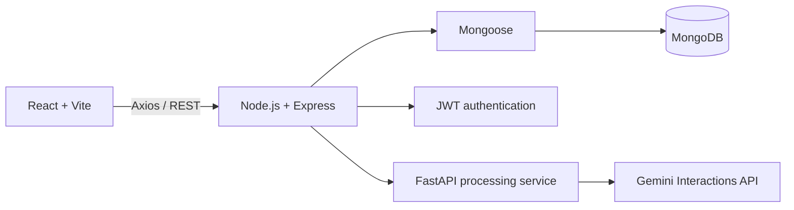
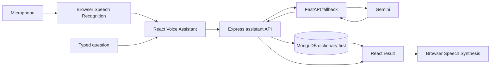
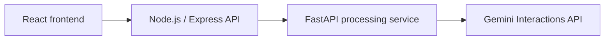

# Slangify – An AI-Powered Slang Translator and Voice Assistant

Slangify helps users discover, understand, search, save, contribute, and listen to modern Gen Z and internet slang.

> **AI status:** The FastAPI service is integrated with Google's Gemini API for contextual fallback. Add your own private `GEMINI_API_KEY` to use live AI; automated tests mock provider responses and do not prove a live account works. Browser Speech Recognition and Speech Synthesis handle voice input/output.

## Overview

Slangify is a full-stack slang dictionary built with React, Express, and MongoDB. It combines public dictionary browsing with authenticated community contributions, persistent favorites, owner-controlled slang changes, responsive theming, and a database-backed voice assistant.

## Features

- Registration, login, logout, JWT authentication, and session restoration
- Public slang search and single-entry lookup
- Category, trending, and A–Z filters
- Popular, newest, and alphabetical sorting with pagination
- Authenticated slang creation and owner-only update/deletion APIs
- Persistent, user-specific MongoDB favorites
- Homepage, Explore, Favorites, Add Slang, authentication, and Voice Assistant pages
- Light/dark themes and responsive layouts
- Homepage and assistant Speech-to-Text input
- Typed natural-language questions such as “What does rizz mean?”
- Text-to-Speech for dictionary meanings and AI translations
- MongoDB-first assistant queries with Gemini fallback for contextual sentences and unknown terms
- Loading, empty, validation, API-error, and unsupported-browser states

## Tech stack

| Area | Technologies |
| --- | --- |
| Frontend | React 19, Vite 8, React Router 7, Axios 1, Lucide React |
| Backend | Node.js, Express 5, FastAPI, Uvicorn, CORS, dotenv |
| Database | MongoDB, Mongoose 8 |
| Authentication | JSON Web Tokens, bcryptjs |
| Voice | Browser `SpeechRecognition`/`webkitSpeechRecognition`, `speechSynthesis` |
| Testing | Vitest, Supertest, mongodb-memory-server, jsdom, React Testing Library |
| Development | npm, Nodemon, ESLint |

## Architecture



The frontend uses one Axios client configured by `VITE_API_URL`. Express routes call controllers, controllers use Mongoose models, and MongoDB stores users, slang, ownership, and favorites.

### Voice flow



Typed and recognized questions share the same normalization and API lookup path. Meanings and examples are not hardcoded.
Simple exact slang queries use MongoDB without calling Gemini; contextual sentences and unknown terms use the FastAPI fallback.

## Project structure

```text
slangify/
├── backend/
│   ├── config/          # Database, CORS, and environment configuration
│   ├── controllers/     # Request handlers
│   ├── data/            # Seed data
│   ├── middleware/      # JWT protection and error handling
│   ├── models/          # Mongoose models
│   ├── routes/          # Express routes
│   ├── scripts/         # Database seeding
│   ├── tests/           # Isolated API integration tests
│   ├── app.js           # Testable Express application factory
│   └── server.js        # Database connection and startup
├── python-service/
│   ├── app/              # FastAPI application, routes, and schemas
│   ├── tests/            # Python endpoint tests
│   ├── requirements.txt
│   └── requirements-dev.txt
├── frontend/
│   ├── components/      # Shared UI components
│   ├── pages/           # Pages, styles, and page tests
│   ├── public/          # Public assets
│   └── src/
│       ├── context/     # Authentication state
│       ├── hooks/       # Browser speech hooks
│       ├── services/    # Axios API services
│       ├── test/        # Test setup
│       ├── theme/       # Theme state
│       └── utils/       # Query normalization
├── ENVIRONMENT.md
├── TESTING.md
└── README.md
```

## Local installation

Prerequisites: Node.js compatible with the installed packages, npm, Python 3.12 (the tested version), and local MongoDB or MongoDB Atlas.

```bash
git clone <your-repository-url>
cd slangify

cd backend
npm install

cd ../frontend
npm install

cd ../python-service
python -m venv .venv
.venv\Scripts\python.exe -m pip install -r requirements.txt
```

## Environment variables

Copy the supplied examples:

```powershell
Copy-Item backend/.env.example backend/.env
Copy-Item frontend/.env.example frontend/.env
Copy-Item python-service/.env.example python-service/.env
```

On macOS/Linux, use `cp` instead of `Copy-Item` and `.venv/bin/python` instead of `.venv\Scripts\python.exe`. On Windows with PowerShell script execution disabled, use `npm.cmd` and run `.venv\Scripts\python.exe -m uvicorn app.main:app --reload --port 8000` without activating the environment.

### Backend: `backend/.env`

| Variable | Required | Purpose |
| --- | --- | --- |
| `MONGO_URI` | Yes | MongoDB connection string |
| `JWT_SECRET` | Yes | Private JWT signing and verification key |
| `CLIENT_URL` | Yes | Exact frontend origin allowed by CORS |
| `PYTHON_SERVICE_URL` | Yes | Internal FastAPI base URL |
| `PORT` | No | API port; defaults to `5000` |

```env
PORT=5000
MONGO_URI=your_mongodb_connection_string
JWT_SECRET=replace_with_a_long_random_secret
CLIENT_URL=http://localhost:5173
PYTHON_SERVICE_URL=http://localhost:8000
```

### Frontend: `frontend/.env`

| Variable | Required | Purpose |
| --- | --- | --- |
| `VITE_API_URL` | Yes | API base URL, including `/api` |

```env
VITE_API_URL=http://localhost:5000/api
```

`VITE_` values are public client configuration and must never contain secrets. Never commit `.env`; commit only `.env.example`. See [ENVIRONMENT.md](ENVIRONMENT.md) for more detail.

## Running locally

Start the backend:

```bash
cd backend
npm run dev
```

Start the frontend in another terminal:

```bash
cd frontend
npm run dev
```

Start FastAPI in a third terminal:

```powershell
cd python-service
.venv\Scripts\Activate.ps1
uvicorn app.main:app --reload --port 8000
```

On macOS/Linux, activate with `source .venv/bin/activate`.

To enable AI fallback, copy `python-service/.env.example` to `python-service/.env` and set a private `GEMINI_API_KEY`. `GEMINI_MODEL` defaults to `gemini-2.5-flash`. Never put this key in `frontend/.env` or a `VITE_` variable.

With the examples, Vite typically uses `http://localhost:5173` and the API port is `5000`.

Optional database seed command:

```bash
cd backend
npm run seed
```

Seeding deletes all existing slang entries before inserting the sample dictionary. Use only a dedicated test database; it does not clear users or their saved favorite references.

## API reference

Endpoints use the `/api` prefix. Protected requests provide `Authorization: Bearer <token>`.

| Method | Endpoint | Access | Description |
| --- | --- | --- | --- |
| GET | `/api/test` | Public | Return API status |
| GET | `/api/ai/health` | Public | Check FastAPI health through Express |
| POST | `/api/ai/process` | Public | Proxy a validated AI processing request to FastAPI |
| POST | `/api/assistant/query` | Public | MongoDB-first assistant query with AI fallback |
| POST | `/api/auth/register` | Public | Register and return a JWT session |
| POST | `/api/auth/login` | Public | Log in and return a JWT session |
| GET | `/api/auth/me` | Protected | Restore the authenticated user |
| GET | `/api/slang` | Public | Search, filter, sort, and paginate slang |
| POST | `/api/slang` | Protected | Create slang owned by the current user |
| GET | `/api/slang/:id` | Public | Retrieve one slang entry |
| PUT | `/api/slang/:id` | Owner only | Update the owner's slang entry |
| DELETE | `/api/slang/:id` | Owner only | Delete the owner's slang entry |
| GET | `/api/favorites` | Protected | Return the current user's favorites |
| POST | `/api/favorites/:slangId` | Protected | Add a favorite without duplicates |
| DELETE | `/api/favorites/:slangId` | Protected | Remove a favorite |

### Slang query parameters

| Parameter | Accepted values |
| --- | --- |
| `search` | Case-insensitive text matched against word, meaning, and tags |
| `category` | `Social Media`, `Meme`, `Gaming`, `Lifestyle`, `Gen Z`, `Other` |
| `letter` | One A–Z character |
| `trending` | `true` or `false` |
| `sort` | `popular`, `newest`, `alphabetical` |
| `page` | Positive integer; default `1` |
| `limit` | Positive integer; default `12`, maximum effective value `50` |

```text
GET http://localhost:5000/api/slang?search=rizz&sort=popular
GET http://localhost:5000/api/slang?letter=D&category=Social%20Media&page=1&limit=12
```

## Voice Assistant

The assistant detects `window.SpeechRecognition` with a `window.webkitSpeechRecognition` fallback. It records one English utterance, displays the transcript, and sends the original question to `POST /api/assistant/query`. Typed input uses the same endpoint. Express checks MongoDB for confident simple-term matches before calling FastAPI/Gemini for contextual or unknown queries.

`window.speechSynthesis` and `SpeechSynthesisUtterance` read the dictionary word/meaning or AI translation aloud. Voice responses speak automatically when TTS is supported; typed responses offer Listen. Previous speech is cancelled before another utterance begins.

Recognition support varies by browser and may require HTTPS, network access, and microphone permission. Typed questions remain available when recognition is unsupported or denied.

FastAPI or Gemini downtime does not interrupt matched MongoDB dictionary answers. Contextual requests receive a safe unavailable message.

## Testing and quality

Automated backend, frontend, and Python tests cover routing, voice UI behavior, and mocked provider failures. See [TESTING.md](TESTING.md) for current run commands and manual voice checks. Live Gemini generation requires your own key and manual verification.

```bash
cd backend
npm test

cd ../python-service
.venv\Scripts\python.exe -m pytest

cd ../frontend
npm test
npm run lint
npm run build
```

Backend tests use temporary in-memory MongoDB and do not use the configured `MONGO_URI`. Manual voice, end-to-end, and responsive checks are in [TESTING.md](TESTING.md).

## Security

- bcrypt password hashing
- JWT-protected account, favorites, and slang mutation routes
- Server-assigned slang ownership and owner-only update/deletion
- Server-side input, ID, filter, and pagination validation
- Environment-based secrets and configurable non-wildcard CORS
- Safe API errors that avoid returning internal details

## Deployment configuration

For Vercel, use `frontend` as the project root, `npm run build` as the build command, and `dist` as the output directory. `frontend/vercel.json` routes direct links such as `/explore` to the React app. Production requires frontend build variable:

```env
VITE_API_URL=https://<backend-domain>/api
```

The backend requires private `MONGO_URI` and `JWT_SECRET` values, the deployed frontend origin as `CLIENT_URL`, and the internal FastAPI base URL as `PYTHON_SERVICE_URL`; `PORT` is optional. Rebuild the frontend after changing `VITE_API_URL` because Vite injects it at build time.

## FastAPI and Gemini integration

The FastAPI service calls Gemini's Interactions API for one schema-constrained generation per fallback query. Pydantic validates the returned translation, explanation, and detected slang before Express returns it to React. The key stays in the Python service environment.



## Future scope

- Improve contextual slang interpretation with evaluation data and human review
- Submission moderation and an administration dashboard
- Recommendation, trending, analytics, and speech-support improvements
- Google OAuth or other identity providers
- Automated CI and deployment pipelines

## Contributing and development

Keep changes focused, preserve current API behavior, and never commit credentials or private environment files. Add behavior-oriented tests for code changes and run the relevant tests, lint, and build commands before submitting work.

For a college demonstration, use a dedicated test database and follow the flow in [TESTING.md](TESTING.md).


## Gen Z Buzz — real news

The standalone **Gen Z Buzz** page at `/genz-buzz` shows the five most recently published eligible articles from public publisher RSS/Atom feeds: The Verge, BBC Technology, BBC Entertainment, and The Guardian Games, Music, and Lifestyle. No news API key, account, Gemini call, or Python service is required for news. Article titles, summaries, images and publication timestamps come from publishers; unavailable images show an explicit placeholder rather than invented artwork.

Run `npm install` in `backend` to install the RSS parser/HTML decoder, then start Express and React normally. Optional backend-only setting in `backend/.env`:

```env
NEWS_CACHE_MINUTES=45
```

The cache setting is clamped to 30–60 minutes. The standalone page uses the existing RSS backend; no new environment variables are needed. `GET /api/news` returns `{ success, data, updatedAt, nextRefreshAt, stale, partial }`. Each article has `id`, `title`, `summary`, `source`, `topic`, `publishedAt`, `image` (nullable), and original `url`. No key is sent to React. The API ignores refresh/force query parameters: Refresh reads the same shared cache, concurrent requests share a single fetch, and the open Gen Z Buzz page checks automatically every 45 minutes. The next request after cache expiry fetches current feeds; no background job runs while the app is idle.

Filtering requires a real publication date and original HTTP(S) URL, removes stories older than 72 hours or in the future beyond a five-minute clock-skew tolerance, strips HTML/tracking parameters, and removes duplicate canonical URLs/headlines. A deterministic keyword/topic relevance score filters stories, then newest publication time determines order (relevance breaks ties); it is editorial filtering, not a claim of measured social popularity. Exactly five are returned when at least five eligible unique articles exist; fewer or zero are shown honestly otherwise. Publisher timestamps are displayed in the reader's local timezone.

If some feeds fail, remaining feeds still work. On a total outage, recent cached stories are marked stale and retained only within the 72-hour limit; without cached data the API returns a friendly 503 with a five-minute retry cooldown. The cache is in memory per Express process and resets on restart. Multi-instance hosting should share a cache if a global fetch budget is needed. Publisher image hosts or original articles may be unavailable, blocked, or paywalled. RSS access and reuse remain subject to each publisher's terms; attribution and original article links are always visible.

Run `npm test` in backend and frontend for filtering, parsing, caching, concurrency, outages, rendering, refresh, and feature regression tests. `node readiness-artifacts/check-news.cjs` performs a read-only live browser check with the existing servers on ports 5173/5000 and installed Chrome, checking real results, refresh/cache reuse, standalone Gen Z Buzz navigation, publisher links, images, mobile widths, and both themes; it saves `readiness-artifacts/news-browser.json` and screenshots. This check never writes to MongoDB or calls Gemini.


Gen Z Buzz has its own gradient navigation button **between Explore and Favorites**, with an active state on `/genz-buzz` and a collapsible mobile menu. News is not embedded in Home or Explore. The **Refresh News** button uses the existing backend cache. Direct visits and browser reloads work with the Vite development server; production static hosts must serve `index.html` for React routes such as `/genz-buzz` (the same SPA fallback needed by `/explore` and other routes). Existing RSS sources and backend environment settings are unchanged; no additional setup or news API key is required.
